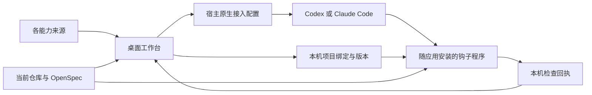

# Agent Workbench（Agent 工作台）设计方案

评审稿 · 2026-11-23

## 产品定位

在现有 OpenSpecGUI 仓库内演进成一个服务于当前团队的独立桌面应用。成员安装一次，在界面中为项目和已安装的 Agent 宿主接入 Skills、MCP、Tools 和基础规范。每项能力从自己的来源接入并独立管理。成员继续从 Codex 或 Claude Code 的原生入口工作。宿主在对应事件上执行随应用安装的钩子程序，桌面窗口关闭后仍可运行。

OpenSpec 是项目侧栏的一级分区，也是团队推广规范协作的主入口。工作台同时支持普通 Git 仓库，团队可以先普及基础能力，再按项目引入 OpenSpec。

产品设计和验收以当前团队的工作流为准。以后跨团队推广时，直接共享应用，由接收团队自行配置、使用或修改。接收团队的维护者可在仓库中调整能力来源，每位成员在应用中维护自己的项目绑定和宿主接入。

## 界面与操作路径

```text
Agent 工作台
  当前项目  [选择仓库或 worktree ▾]

  Agent 配置
    能力绑定       从团队目录为当前项目选用能力、配置和验证
    钩子记录       检查的触发、结果和原因

  OpenSpec
    执行台         活跃提案、当前任务和待审阅归档
    专项           关联提案与专项成果
    规范           当前检出版本的正式规范
    归档           已归档提案与历史资料

  ─────────────────────────────────
  全局
    宿主接入       检测版本、注册入口、诊断与解除接入
```

OpenSpec 四个入口平铺在侧栏。有 OpenSpec 的项目首次打开进入「执行台」，普通仓库进入「能力绑定」。此后记住各项目上次访问的页面。切换项目时，项目分区随仓库切换。全局页继续显示本机状态。OpenSpec 读取和归档各自显示可用性，宿主未连接时仍能浏览项目提案与规范。沿用现有固定侧栏与项目切换模式。[视觉规范](../../openspec/specs/workbench-visual-system/spec.md) · [桌面工作台规范](../../openspec/specs/desktop-workbench/spec.md)

| 使用者 | 主要路径 | 完成时看到的结果 |
| --- | --- | --- |
| 新成员 | 安装工作台 → 选择项目和宿主 → 在「能力绑定」选用团队已收录的能力 → 完成所需授权并验证 | 可以看到该项目实际采用的能力、版本和授权状态 |
| OpenSpec 日常使用者 | 选择项目 → 执行台或规范 → 查看任务、证据和差异 → 审阅归档 | 提案与归档结果回到当前仓库，检查结果能从对应项目的钩子记录查到 |
| 能力维护者 | 在工作台仓库更新能力目录，登记稳定 ID、来源、版本与所需权限 → 验证 → 发布工作台版本 | 成员更新应用后可看到新增条目或可选版本 |

同一工作台版本在每个项目中展示相同的团队能力目录，包含 Skills、MCP、Tools 和基础规范。新项目的绑定从空列表开始。成员选定项目后，在「能力绑定」里逐项选择宿主、版本和项目参数。尚未选定项目时，绑定入口引导成员先选择或添加项目。旧版「能力接入」链接也按这一规则进入。

| 入口 | 主要管理内容 |
| --- | --- |
| Skills | Skill 的来源、可选版本、宿主发现状态和启用范围 |
| MCP | 服务地址或启动配置、个人授权和连接状态。远程服务的运行版本以服务所能提供的信息为准 |
| Tools | 脚本或命令的来源与版本、宿主自带工具的可用性、MCP 工具所属的连接 |
| 基础规范 | 通用规范的来源、版本和适用范围。项目自己的正式规范继续从 OpenSpec 的「规范」入口查看 |

目录收录由维护者在工作台仓库中完成。显示别名是本机界面偏好，个人账号可在所选项目中明确使用。绑定通过稳定 ID 关联能力。迁移时保留已有项目绑定与引用的来源快照，旧版全局启用记录供成员核对并在所需项目明确选择。全局「宿主接入」管理本机原生钩子的挂载和诊断，项目的「钩子记录」展示实际触发结果。

### 团队版本怎样送达成员

能力目录随整个工作台发版，由应用内更新完成分发。工作台仓库已有内置目录与 macOS ZIP 构建。分发端需要一个成员电脑可读取的固定 HTTPS 地址，存放各架构的版本清单和带版本号的更新包。团队已有的内网站点或对象存储均可承载这些静态文件。发布流程有写权限，成员端只读。打包和发布流程见 README 的「团队整包发布」。团队正式更新地址及首次签名版的线上升级验收仍待落实。[内置目录](../../src/capabilities/catalog.json) · [Forge 配置](../../forge.config.js)

1. 维护者在仓库收录或更新单项能力，写明版本说明，发布新的工作台版本。发布流程生成并检查对应架构的签名、公证产物，将带版本号的 ZIP 上传到团队可访问的固定 HTTPS 地址，确认可下载后更新该架构的 `RELEASES.json`。发布脚本从实际发行 ZIP 生成各架构清单。
2. 成员首次安装支持更新的签名版。此后工作台在后台检查版本，成员查看说明并同意下载后，应用核对整包并提示重启。应用菜单中也可选择「检查更新…」。暂缓重启、离线或下载失败时可继续使用当前版本。
3. 更新后，新能力出现在清单中供成员选用。已绑定能力有新版时显示可升级，由成员在对应范围确认。各项目继续引用本机保存的固定版本，个人令牌、项目配置及别名沿用原记录。

例如维护者发布飞书缺陷 Skill 新版后，每个项目都能看到可选版本。成员可先在 WorldTourCasino 的一个工作树采用新版。另一个工作树按自己的选择继续使用旧版，或保持未启用。

## 配置和数据归属

| 归属 | 存放位置 | 内容 |
| --- | --- | --- |
| 能力来源 | 各自的 Git 仓库、服务、插件或规范库 | Skill、MCP 服务或连接定义、工具入口、钩子检查和通用规范。来源自行维护和发布 |
| 本机工作台 | 应用用户数据目录 | 项目路径、worktree、各项目的能力选择、版本、配置和授权引用，以及本机显示别名、安装台账和钩子回执 |
| Agent 宿主 | 当前用户的宿主配置及登录存储 | 原生钩子入口、受支持的 Skill 与 MCP 接入、宿主信任和授权。凭据由宿主或系统钥匙串保存 |
| 业务项目 | 项目 Git 仓库或团队已有的工作项系统 | 代码、`AGENTS.md`、`openspec/`、项目脚本与团队审阅结果。个人路径、启用项和回执由工作台保存 |

每项能力用稳定标识登记。可固定的来源保存版本或提交以及必要的内容摘要。MCP 远程服务保存连接引用和已验证状态。成员接入时确认条目、启用范围和宿主。

项目配置以真实仓库根和当前 worktree 为准。钩子根据事件提供的工作目录解析实际项目，遇到工作目录缺失或绑定含糊时按检查项的策略处理并记录原因。联调条目通过显式选择接入。本机记录已实际采用的来源和版本。可执行的能力从成员认可的来源获取并校验对应版本。

有效能力由当前项目为所选宿主显式启用的绑定决定。界面区分已收录、已启用和宿主已验证。必需规则冲突时显示两边的来源，待维护者解决后再应用。目录中仍显示宿主无法按项目隔离的能力，并标记「当前宿主不支持项目级启用」。

## 应用结构与运行方式



桌面端复用现有 Electron 外壳、主题、项目选择器、原子写入的注册表和 OpenSpec 服务。项目注册从检测是否有 `openspec/` 改为识别仓库，再由 OpenSpec 模块判断是否可用。正式规范和归档仍由该模块处理。界面通过受校验的命名操作请求接入、预览和归档。钩子程序位于固定的用户级安装目录，可直接读取本机已应用的版本信息并写入回执。它独立于桌面进程和应用包的内部路径。[现有窗口与启动逻辑](../../src/main/index.js) · [项目注册器](../../src/main/project-registry.js)

每个宿主适配器负责检测版本、生成该宿主原生入口、检查信任状态和解释结果。可将多个检查项挂到同一个事件，统一交由同一个钩子程序运行。每项检查声明宿主事件、适用范围、前置条件、执行上限和失败行为。远程开发机或 CI 通过相同版本的无界面组件接入各自的执行环境，厂商托管执行环境按其实际支持的机制单独验证。[Codex 钩子](https://developers.openai.com/codex/hooks) · [Claude Code 钩子](https://code.claude.com/docs/en/hooks)

### 挂载、更新和回退

1. 接入预览列出目标宿主、项目范围、版本变化、权限需求和将写入的配置项。成员按界面引导完成宿主自己的信任和登录流程。
2. 应用先在本机准备并校验新版本，再切换引用。每个文件独立替换，安装台账记录写入前后摘要和进度。中断后用台账识别已经完成的写入。仅在当前文件仍匹配本次写入结果时自动回退，发现外部修改则显示冲突。
3. 选定能力及绑定在应用成功后切换至新版本。同一能力也可保留其他项目采用的版本。界面提示宿主需要的新会话或重新加载步骤，保留回退版本和仍被引用的版本，等宿主重新加载或解除引用后再清理。
4. 重复接入复用已有条目。回退和解除接入只处理本次安装管理的条目，保留成员手写配置。解除引用后清理本机缓存。

### 钩子执行与证据

`SessionStart` 负责识别项目、提供当前标准入口与环境诊断。需要机械判断的操作使用同步的 `PreToolUse`，由代码读入项目和规则版本。校验通过后继续宿主的权限判断，未通过则向宿主返回明确拒绝。Skill 和 MCP 由宿主原生机制加载，规范文本给 Agent 提供上下文，必须遵守的检查由钩子、受控工具或最终的合并与发布入口执行。

界面区分「已挂载」「待信任」「待验证」「已验证」「不支持或异常」。只有真实宿主会话的回执可以把对应项目、宿主版本和检查项版本标为「已验证」。回执记录时间、事件、检查项、结果和简短原因。项目路径、授权状态等诊断只留本机，回执只保留判断所需的最少字段。策略或宿主变化时提示重新验证。

校验明确拒绝和钩子自身超时是两种结果。每个适配器按实际覆盖范围和异常行为标识能否阻断。某个宿主出现故障时会继续执行的检查，在界面显示该限制。强制失败即停止的操作还需受控执行入口自行校验，供其他入口共用的合并或发布门禁在对应服务端执行。手动执行和未覆盖的工具路径由这些入口各自约束。[Codex 托管钩子及异常行为](https://developers.openai.com/codex/hooks#managed-hooks-from-requirementstoml) · [Claude Code 钩子异常处理](https://code.claude.com/docs/en/hooks#block-the-action-when-a-hook-fails)

## OpenSpec 与人机协作

建议用 WorldTourCasino 做归档试点。GUI 和 Agent 入口复用同一个只读预检规则，判断 Change 身份、锁定的官方 CLI 可用性、严格校验与增量规范状态。若项目要求归档前完成增量规范同步，两个入口都按项目绑定的检查规则先行校验。GUI 使用现有隔离快照计算归档计划，展示正式规范差异和目标路径，由负责人确认后按现有事务提交。Agent 在受控入口按项目既有的官方 OPSX 流程执行，在归档写入前完成同样的预检。两个入口各自复核计划所依据的文件版本。跨入口的写事务和并发控制留待验证两条流程后再设计。

例如校验发现变更缺少必要产物，Agent 调用受控归档入口时收到拒绝原因，负责人从侧栏的「钩子记录」查看。修正后可重新验证，并从「执行台」进入原有归档审阅。任务勾选、结构校验、人工验收和实际归档分别展示其结果。[归档契约](../../openspec/specs/change-archive/spec.md) · [现有归档计划](../../src/core/archive-plan.js) · [现有审阅服务](../../src/main/change-archive-service.js)

## 首版交付与验收

首版以 macOS 团队试点为交付建议。优先做项目注册与侧栏、各类能力的逐项接入和项目绑定，以及 Codex 和 Claude Code 的接入验证，再接通 OpenSpec 归档预检。团队安装包沿用现有 Electron 打包流程，内测分发前验证签名、公证和干净环境安装。[现有打包说明](../../README.md#打包)

| 验收项 | 通过条件 |
| --- | --- |
| 新成员接入 | 在「能力绑定」选用团队已收录的能力，完成个人授权和一次只读调用。业务仓库中不产生个人配置变更 |
| 团队更新 | 在上一版签名客户端收到新版，重启后可见新条目或可选版本，旧项目的固定版本、本机别名和个人授权仍可用 |
| 原生钩子触发 | 关闭工作台，用两种宿主分别开启新会话。对两条无害测试操作各验证一次放行和拒绝，用一次性测试 ID 将工具调用、钩子回执和操作的实际结果关联起来。记录超时或缺失时的表现 |
| 项目范围 | 在项目 A 启用并配置一项能力，切换到首次打开的项目 B，仍能看见同一目录且所有条目均未绑定。单独配置 B 后，再切回 A 可恢复 A 的配置 |
| OpenSpec 日常操作 | 直接从侧栏进入执行台、专项、规范和归档。提案状态与官方 CLI 一致，归档仍可预览差异和确认。宿主待信任时可正常浏览 |
| 版本恢复 | 在一个项目中更新一项 Skill 后回退到原版本，核对其余能力和另一个项目的绑定。重复接入只保留一条登记，人为修改的配置得到保留并提示冲突 |
| 跨设备复现 | 两位成员在各自设备从相同来源接入同一项能力，选定相同版本和启用范围，各自完成授权与本机验证。团队审阅结果通过项目已有渠道共享 |
